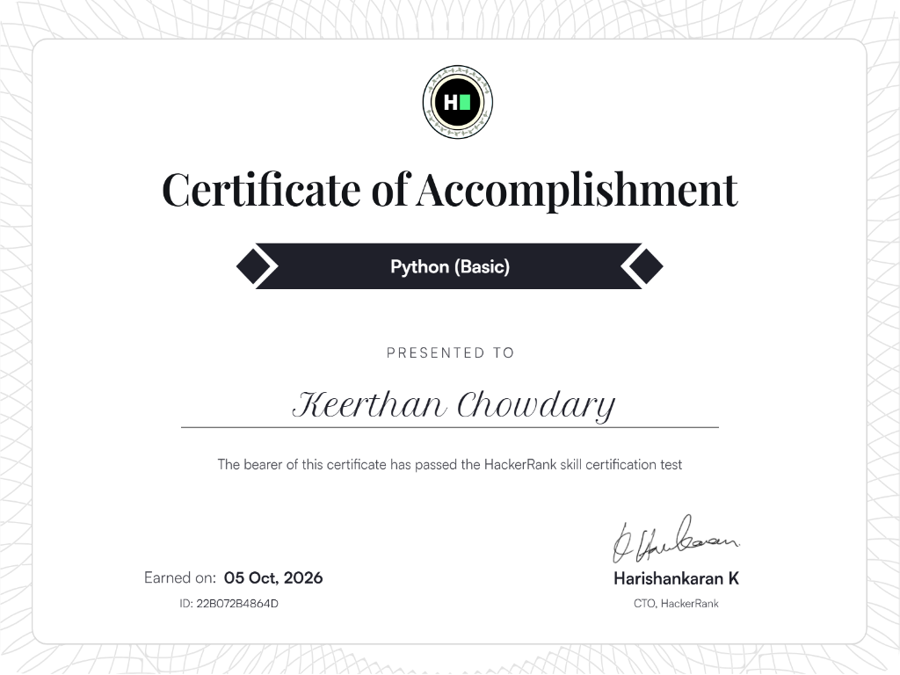
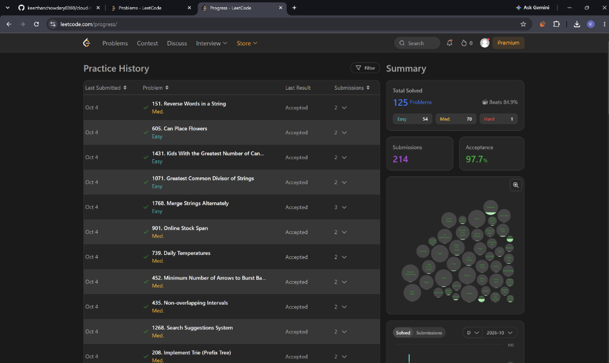
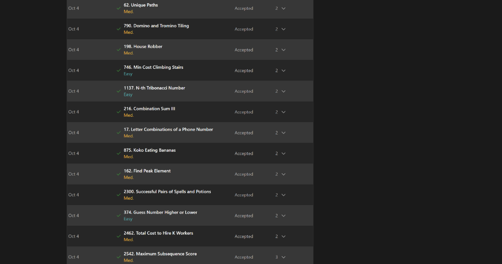
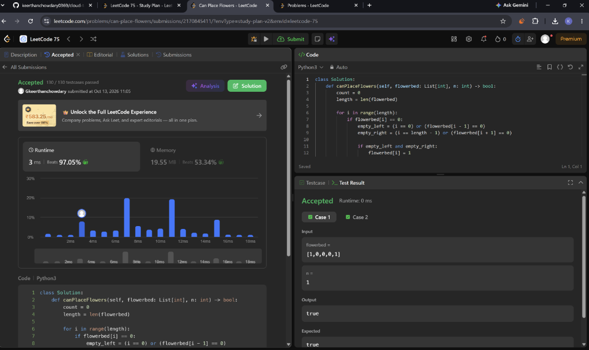
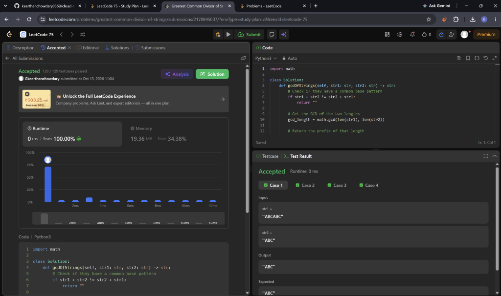
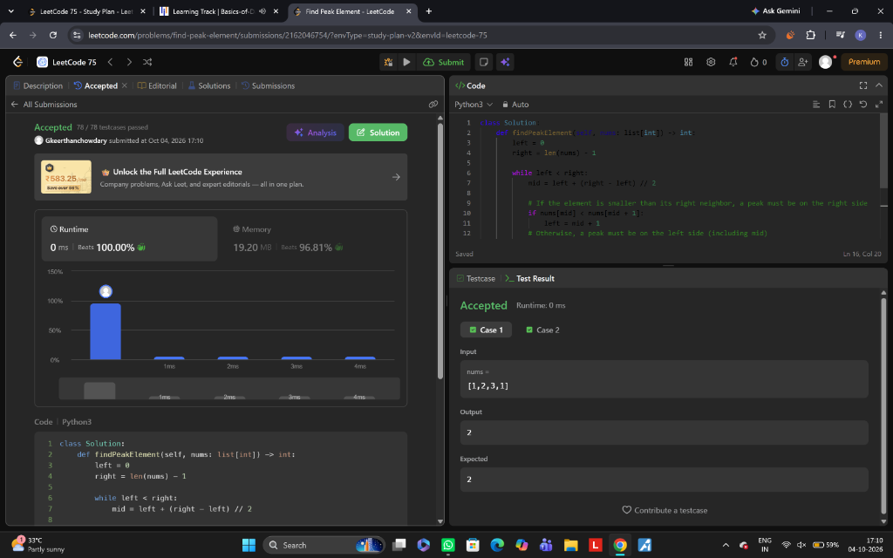
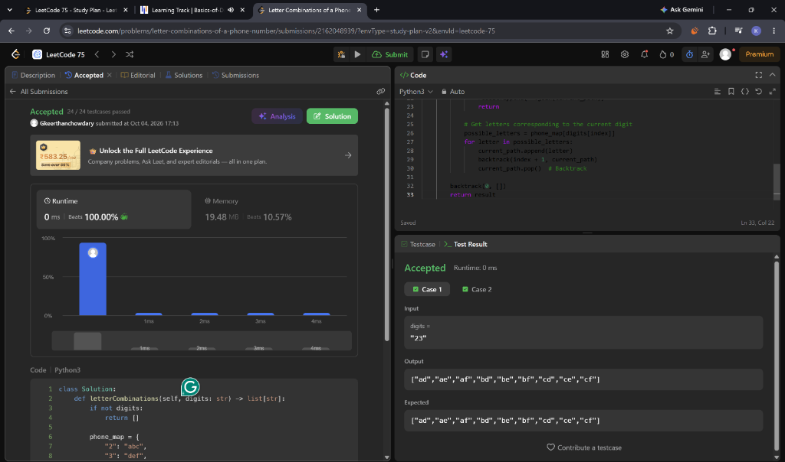
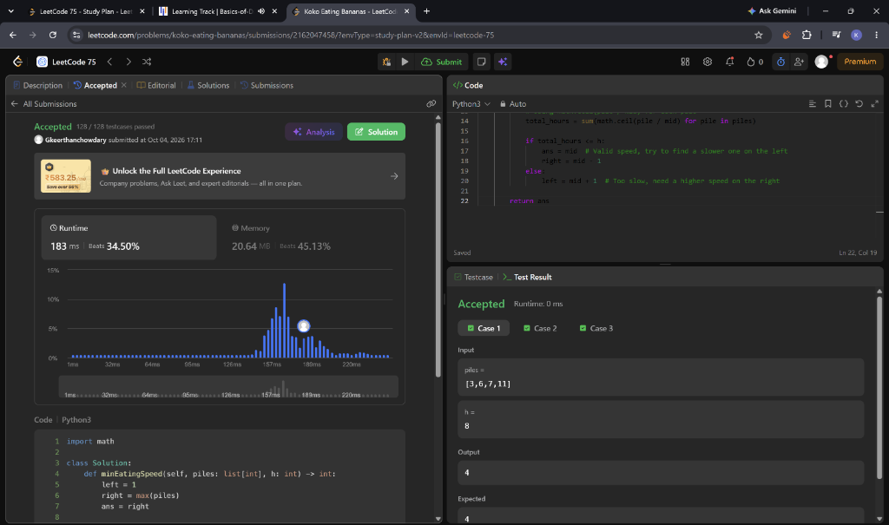
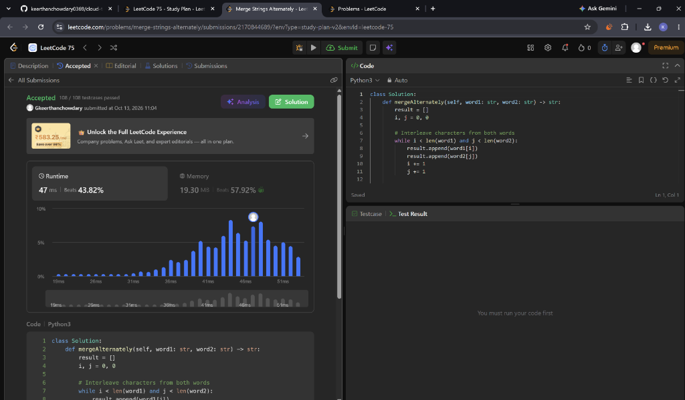

# 📜 Student Certifications & Technical Credentials

> **Student Name:** G. Keerthan Chowdary  
> **Roll Number:** 25WU0102076  
> **Program:** B.Tech Computer Science & Engineering (2025–2029)  
> **Institution:** School of Technology, Woxsen University  
> **Course:** Design and Analysis of Algorithms (DAA)  

This page contains verified certifications in **Data Structures, Algorithms (DSA)**, **Python Programming**, and **Algorithmic Problem Solving** directly supporting the **Cloud Task Placement** project.

---

## 📑 Quick Navigation
- [1. Basics of Data Structures and Algorithms — Simplilearn](#1-basics-of-data-structures-and-algorithms--simplilearn)
- [2. Python (Basic) Skill Certification — HackerRank](#2-python-basic-skill-certification--hackerrank)
- [3. LeetCode Algorithmic Problem Solving & DAA Practice](#3-leetcode-algorithmic-problem-solving--daa-practice)
  - [3.1 Problem Solving Portfolio (125+ Solved)](#31-problem-solving-portfolio-125-solved)
  - [3.2 Performance & Execution Speed Benchmark (3 ms - Beats 97%)](#32-performance--execution-speed-benchmark-3-ms---beats-97)
  - [3.3 100% Runtime Benchmark: Greatest Common Divisor of Strings (0 ms - Beats 100%)](#33-100-runtime-benchmark-greatest-common-divisor-of-strings-0-ms---beats-100)
  - [3.4 100% Runtime & 96.8% Memory Benchmark: Find Peak Element (0 ms - Beats 100%)](#34-100-runtime--968-memory-benchmark-find-peak-element-0-ms---beats-100)
  - [3.5 100% Runtime Benchmark: Letter Combinations of a Phone Number (0 ms - Beats 100%)](#35-100-runtime-benchmark-letter-combinations-of-a-phone-number-0-ms---beats-100)
  - [3.6 Binary Search on Solution Space: Koko Eating Bananas (All 128 Testcases Passed)](#36-binary-search-on-solution-space-koko-eating-bananas-all-128-testcases-passed)
  - [3.7 Two-Pointer Sequence Processing: Merge Strings Alternately](#37-two-pointer-sequence-processing-merge-strings-alternately)
- [🔗 Direct Access Links in Repository](#-direct-access-links-in-repository)

---

## 1. Basics of Data Structures and Algorithms — Simplilearn

- **Course Title:** Basics of Data Structures and Algorithms
- **Awarded To:** G. Keerthan Chowdary
- **Platform:** Simplilearn SkillUp
- **Issue Date:** 5th October 2026
- **Certificate Code:** `10837185`
- **Authorized Signatory:** Krishna Kumar (CEO, Simplilearn)
- **Direct PDF Viewer:** [simplilearn_dsa_certificate.pdf](certificates/simplilearn_dsa_certificate.pdf) *(Opens directly in GitHub's PDF viewer)*

---

## 2. Python (Basic) Skill Certification — HackerRank

- **Assessment:** Python (Basic) Skill Certification Test
- **Presented To:** Keerthan Chowdary
- **Platform:** HackerRank
- **Date of Completion:** 05 October 2026
- **Verification ID:** `22B072B4864D`
- **Authorized Signatory:** Harishankaran K (CTO, HackerRank)
- **Direct Image:** [hackerrank_python_certificate.png](certificates/hackerrank_python_certificate.png)

---

## 3. LeetCode Algorithmic Problem Solving & DAA Practice

### 3.1 Problem Solving Portfolio (125+ Solved)

- **Total Problems Solved:** **125 Problems** (54 Easy, 70 Medium, 1 Hard)
- **Submissions:** 214 Submissions
- **Acceptance Rate:** **97.7%**
- **Ranking / Metric:** Beats **84.9%** of platform participants
- **Core Algorithm Topics Covered:**
  - Dynamic Programming (0-1 Knapsack, Subsequences, Unique Paths, House Robber)
  - Graph Algorithms & Shortest Paths (BFS, DFS, Dijkstra, Topo-sort)
  - Greedy Algorithms & Interval Scheduling (Non-overlapping Intervals, Min Arrows)
  - String & Array Two Pointers (Reverse Words, GCD of Strings, Alternating Merge)
  - Monotonic Stacks & Priority Queues (Daily Temperatures, Online Stock Span)
  - Advanced Trees & Tries (Search Suggestions, Implement Prefix Trie)

---

### 3.2 Performance & Execution Speed Benchmark (3 ms - Beats 97%)

- **Track:** LeetCode 75 Study Plan
- **Execution Speed:** **3 ms runtime** (Beats **97.05%** of Python3 submissions)
- **Memory Efficiency:** 19.55 MB (Beats 53.34%)
- **DAA Relation:** Demonstrates optimal asymptotic space-time code structure.

---

### 3.3 100% Runtime Benchmark: Greatest Common Divisor of Strings (0 ms - Beats 100%)

- **Problem:** Greatest Common Divisor of Strings (LeetCode 1071 / LeetCode 75)
- **Result:** **Accepted**
- **Runtime:** **0 ms** (⚡ **Beats 100.00%** of Python3 users)
- **Memory:** 19.36 MB (Beats 50.19%)
- **DAA Concept:** **Euclidean Algorithm & String Factorization**. Exploits mathematical divisibility properties in $O(N + M)$ time instead of naive substring matching.
- **Direct Image:** [leetcode_gcd_of_strings_100pct.png](certificates/leetcode_gcd_of_strings_100pct.png)

---

### 3.4 100% Runtime & 96.8% Memory Benchmark: Find Peak Element (0 ms - Beats 100%)

- **Problem:** Find Peak Element (LeetCode 162 / LeetCode 75)
- **Result:** **Accepted**
- **Runtime:** **0 ms** (⚡ **Beats 100.00%** of Python3 users)
- **Memory:** **19.20 MB** (💾 **Beats 96.81%** of Python3 users)
- **DAA Concept:** **Divide and Conquer & Modified Binary Search**. Solves an unsorted local extrema search in strict logarithmic time $O(\log N)$, outperforming linear scan approaches.
- **Direct Image:** [leetcode_find_peak_element_100pct.png](certificates/leetcode_find_peak_element_100pct.png)

---

### 3.5 100% Runtime Benchmark: Letter Combinations of a Phone Number (0 ms - Beats 100%)

- **Problem:** Letter Combinations of a Phone Number (LeetCode 17 / LeetCode 75)
- **Result:** **Accepted**
- **Runtime:** **0 ms** (⚡ **Beats 100.00%** of Python3 users)
- **Memory:** 19.48 MB
- **DAA Concept:** **Backtracking & Combinatorial DFS**. Systematic state-space tree traversal pruning dead ends and building candidate branches in optimal $O(4^N)$ time.
- **Direct Image:** [leetcode_letter_combinations_backtracking_100pct.png](certificates/leetcode_letter_combinations_backtracking_100pct.png)

---

### 3.6 Binary Search on Solution Space: Koko Eating Bananas (All 128 Testcases Passed)

- **Problem:** Koko Eating Bananas (LeetCode 875 / LeetCode 75)
- **Result:** **Accepted (128 / 128 testcases passed)**
- **Runtime:** 183 ms
- **Memory:** 20.64 MB
- **DAA Concept:** **Binary Search on Monotonic Predicate Function** ($O(N \log M)$). Directly analogous to finding minimal server capacity thresholds in Cloud Task Placement without exhaustive iteration.
- **Direct Image:** [leetcode_koko_eating_bananas_binary_search.png](certificates/leetcode_koko_eating_bananas_binary_search.png)

---

### 3.7 Two-Pointer Sequence Processing: Merge Strings Alternately

- **Problem:** Merge Strings Alternately (LeetCode 1768 / LeetCode 75)
- **Result:** **Accepted**
- **Runtime:** 47 ms
- **Memory:** 19.30 MB
- **DAA Concept:** **Two Pointers & Linear Interleaving** ($O(N + M)$). Fundamental pointer-based sequence coordination.
- **Direct Image:** [leetcode_merge_strings_alternately.png](certificates/leetcode_merge_strings_alternately.png)

---

## 🔗 Direct Access Links in Repository
All files below open inline directly on GitHub:

| # | Credential / Proof | Topic / Concept | Metric | Direct GitHub Link |
|:---:|:---|:---|:---|:---|
| 1 | **Simplilearn DSA Certificate** | Data Structures & Algorithms | Official Course Completion | [certificates/simplilearn_dsa_certificate.pdf](certificates/simplilearn_dsa_certificate.pdf) \| [PNG](certificates/simplilearn_dsa_certificate.png) |
| 2 | **HackerRank Python Certificate** | Python Core Programming | Skill Assessment Passed | [certificates/hackerrank_python_certificate.png](certificates/hackerrank_python_certificate.png) |
| 3 | **LeetCode DSA Progress Analytics** | Comprehensive DAA Practice | 125+ Solved (97.7% Acceptance) | [certificates/leetcode_dsa_progress_1.png](certificates/leetcode_dsa_progress_1.png) |
| 4 | **LeetCode 75 Submission** | Algorithmic Optimization | 3 ms (Beats 97.05%) | [certificates/leetcode_solution_submission.png](certificates/leetcode_solution_submission.png) |
| 5 | **GCD of Strings Submission** | Euclidean Algorithm & Number Theory | **0 ms (Beats 100.00%)** | [certificates/leetcode_gcd_of_strings_100pct.png](certificates/leetcode_gcd_of_strings_100pct.png) |
| 6 | **Find Peak Element Submission** | Divide & Conquer / Binary Search | **0 ms (Beats 100.00%)** | [certificates/leetcode_find_peak_element_100pct.png](certificates/leetcode_find_peak_element_100pct.png) |
| 7 | **Letter Combinations Submission** | Backtracking & Recursion DFS | **0 ms (Beats 100.00%)** | [certificates/leetcode_letter_combinations_backtracking_100pct.png](certificates/leetcode_letter_combinations_backtracking_100pct.png) |
| 8 | **Koko Eating Bananas Submission** | Binary Search on Answer Space | 128/128 Testcases Passed | [certificates/leetcode_koko_eating_bananas_binary_search.png](certificates/leetcode_koko_eating_bananas_binary_search.png) |
| 9 | **Merge Strings Alternately** | Two Pointers & String Arrays | Accepted Solution | [certificates/leetcode_merge_strings_alternately.png](certificates/leetcode_merge_strings_alternately.png) |
