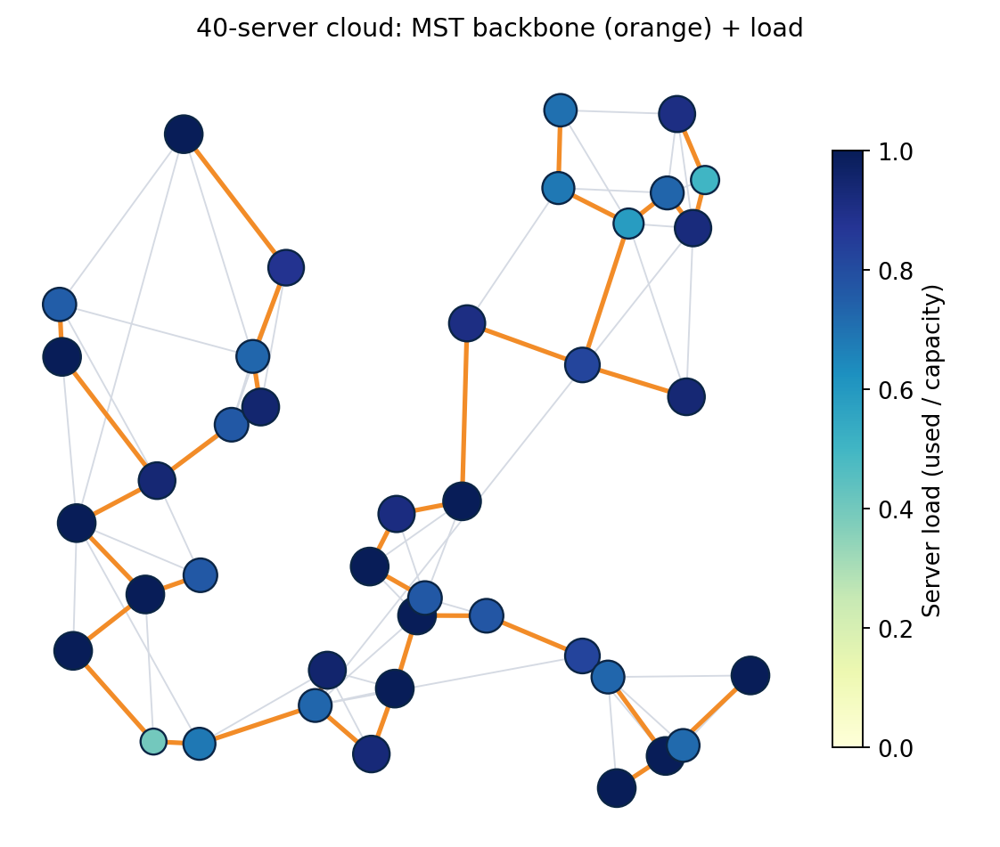

# 📊 Cloud Task Placement — Presentation Slides

> **Design and Analysis of Algorithms | Internal Project**  
> **Institution:** Woxsen University, School of Technology  
> **Course:** B.Tech Computer Science & Engineering (2025–2029)  
> 📥 **Download Native PowerPoint File:** [Cloud_Task_Placement_Project.pptx](Cloud_Task_Placement_Project.pptx)  
> 🌐 **Live Interactive Website:** [cloud placement](https://keerthanchowdary0369.github.io/cloud-task-placement/)  

---

## 📑 Slide Navigator
- [Slide 1: Title & Project Team](#slide-1-title--project-team)
- [Slide 2: 40-Server Cloud Topology Overview](#slide-2-40-server-cloud-topology-overview)
- [Slide 3: Problem Statement & Motivation](#slide-3-problem-statement--motivation)
- [Slide 4: Background & Literature Foundations](#slide-4-background--literature-foundations)
- [Slide 5: Software Requirements Specification (SRS)](#slide-5-software-requirements-specification-srs)
- [Slide 6: Dataset & Mathematical Formulation](#slide-6-dataset--mathematical-formulation)
- [Slide 7: System Design Pipeline](#slide-7-system-design-pipeline)
- [Slide 8: Backbone Network Design with MST](#slide-8-backbone-network-design-with-mst)
- [Slide 9: Algorithm Complexity & Selection Matrix](#slide-9-algorithm-complexity--selection-matrix)
- [Slide 10: Placement Algorithm & Correctness Guarantees](#slide-10-placement-algorithm--correctness-guarantees)
- [Slide 11: Implementation & Prototype Verification](#slide-11-implementation--prototype-verification)
- [Slide 12: Experimental Benchmarking Setup](#slide-12-experimental-benchmarking-setup)
- [Slide 13: Results — Algorithm Runtime vs Size](#slide-13-results--algorithm-runtime-vs-size)
- [Slide 14: Results — Sparse vs Dense Networks (APSP)](#slide-14-results--sparse-vs-dense-networks-apsp)
- [Slide 15: Results — Solution Quality vs MILP Optimum](#slide-15-results--solution-quality-vs-milp-optimum)
- [Slide 16: Results — Overload Resilience (Load Sweep)](#slide-16-results--overload-resilience-load-sweep)
- [Slide 17: Strategic Policy Recommendations](#slide-17-strategic-policy-recommendations)
- [Slide 18: Conclusion & Future Scope](#slide-18-conclusion--future-scope)

---

### Slide 1: Title & Project Team

# Cloud Task Placement
### Latency-aware VM placement using graphs, greedy algorithms and dynamic programming

**Design and Analysis of Algorithms | Internal Project**  
**School of Technology, Woxsen University**  

#### 👥 Project Team
| S. No. | Name | Register Number |
|:---|:---|:---|
| 1 | **Andrew Devasani** | `25WU0102067` |
| 2 | **Sathyanarayana Varma** | `25WU0102088` |
| 3 | **G. Daiwik Reddy** | `25WU0102340` |
| 4 | **G. Keerthan Chowdary** | `25WU0102076` |

*B.Tech CSE (2025–2029), Woxsen University*

---

### Slide 2: 40-Server Cloud Topology Overview



> **40-server cloud:** MST backbone in orange, darker node color indicates fuller capacity utilization ($0.0 \to 1.0$).

---

### Slide 3: Problem Statement & Motivation

#### The Problem
A cloud datacenter infrastructure has servers interconnected by physical links with latency.  
- Each task needs specific capacity units, earns an intrinsic priority value, and originates from a user at a given node.  
- **Objective:** Decide which tasks to run and where, maximizing total utility (value minus latency penalty) such that no physical server is overloaded.

#### Why It Matters
- **Suboptimal placement:** Causes sluggish SLA response times and wasted server resources.  
- **Computational hardness:** Exact solutions do not scale (the Generalized Assignment Problem is NP-hard), so principled heuristics are critical.

#### 3 Core Pillars
1. **Match Algorithms to Subproblems:** MST for backbone reduction, shortest paths for latency matrices, Greedy + DP for combinatorial packing.
2. **Respect Real Constraints:** Strictly enforce physical server capacity limits and network latency penalties.
3. **Measure Trade-Offs:** Theoretical asymptotic bounds validated against measured runtime and exact MILP optimums.

---

### Slide 4: Background & Literature Foundations

| Source | Seminal Contribution | Role in Project Pipeline |
|:---|:---|:---|
| **Kruskal (1956)** | Greedy MST via sorted edges + Union-Find | Backbone control network |
| **Prim (1957)** | Growing MST from root via priority queue | Cross-check verification of Kruskal |
| **Dijkstra (1959)** | Single-source shortest paths (non-negative weights) | Server-to-server latency |
| **Floyd (1962) / Warshall (1962)** | All-pairs shortest paths by Dynamic Programming, $O(V^3)$ | Dense-network latency matrix |
| **Johnson (1977)** | APSP for sparse graphs via Bellman-Ford reweighting | Sparse-network latency matrix |
| **Martello & Toth (1990)** | Knapsack problems: DP and branch-and-bound | Per-server task selection |
| **Cormen et al. (CLRS)** | Algorithmic proofs and asymptotic complexity | Correctness & termination arguments |

> **Gap Addressed:** Textbook algorithms are usually taught separately. This project synthesizes them into an operational placement pipeline and empirically quantifies the architectural trade-offs.

---

### Slide 5: Software Requirements Specification (SRS)

#### Functional Requirements
- **FR1:** Generate or load a synthetic server network and workload.
- **FR2:** Build an MST backbone (Kruskal, Prim).
- **FR3:** Compute all-pairs latency matrix (Dijkstra, Floyd-Warshall, Johnson).
- **FR4:** Place tasks within capacity limits (Greedy proposals + Knapsack DP).
- **FR5:** Benchmark against baselines and the exact MILP optimum.

#### Non-Functional Requirements
- **Correct:** Built-in automated tests cross-check every algorithm.
- **Fast:** Placement of 600 tasks across 80 servers completes in under 0.02 seconds.
- **Reproducible:** Seeded synthetic data generator ensures reproducible figures.
- **Modular:** One Python module per algorithm family.

**Input:** Topology (nodes, link latencies), server capacities, task demands, values, user origins.  
**Output:** Task-to-server plan, total utility, average latency, and policy tables.

---

### Slide 6: Dataset & Mathematical Formulation

#### Network Model (Synthetic 2D Cloud)
- Servers receive random 2D positions on a plane: $(x_i, y_i) \in [0, 1]^2$.
- Latency model:  
  $$\text{Latency} = 1\text{ ms} + \text{dist}(u, v) \times 40\text{ ms} + \text{jitter}(0–2\text{ ms})$$
- Each server links to its nearest earlier server (guaranteeing connectivity).
- Density factor adds extra nearest-neighbour links.

#### Workload Model
- Task demand: $1$ to $10$ capacity units.
- Task value: $5$ to $60$.
- User origin: Assigned to a uniformly random server node.
- Server capacity: Varies between $0.6\times$ and $1.4\times$ the datacenter average.
- Cloud Load Tightness: $\text{Load} = \frac{\sum \text{demand}}{\sum \text{capacity}}$.

#### Utility Formula
$$\text{utility}(t, s) = \text{value}(t) - \lambda \times \text{latency}(\text{origin}(t), s)$$
*(Default $\lambda = 1.0$; a task is admitted only if its utility is positive).*

---

### Slide 7: System Design Pipeline

```
┌─────────────────────────────────┐
│ 1. Topology & Workload          │  --> Adjacency list graph, 2D coordinates, task profiles
└────────────────┬────────────────┘
                 â–¼
┌─────────────────────────────────┐
│ 2. MST Backbone                 │  --> Kruskal (DSU) / Prim (Heap) backbone reduction
└────────────────┬────────────────┘
                 â–¼
┌─────────────────────────────────┐
│ 3. Latency Matrix (APSP)        │  --> Johnson (sparse) or Floyd-Warshall (dense)
└────────────────┬────────────────┘
                 â–¼
┌─────────────────────────────────┐
│ 4. Placement Engine             │  --> Greedy proposal rounds + 0-1 Knapsack DP
└────────────────┬────────────────┘
                 â–¼
┌─────────────────────────────────┐
│ 5. Policy & Benchmark Evaluation│  --> Multi-metric evaluation vs Nearest, Random, MILP
└─────────────────────────────────┘
```

---

### Slide 8: Backbone Network Design with MST

#### Kruskal's Algorithm
- Sort all physical links by latency weight: $O(E \log E)$.
- Add link if it connects two disjoint components using Union-Find (DSU).

#### Prim's Algorithm
- Grow the tree from a seed node using a binary min-heap: $O(E \log V)$.

#### Quantitative Impact
- **74% fewer links** kept than the full mesh ($V - 1$ links).
- **82% to 84% reduction** in total network link cost.
- **Architectural Policy:** Used as a low-cost control backbone for internal replication and health checks. User SLA traffic routes on shortest paths to avoid tree latency stretch.

---

### Slide 9: Algorithm Complexity & Selection Matrix

| Subproblem | Algorithm | Time Complexity | Why Chosen |
|:---|:---|:---|:---|
| **Backbone Network** | Kruskal / Prim | $O(E \log E)$ / $O(E \log V)$ | Two independent methods verify identical tree weight |
| **Single-Source Latency** | Dijkstra | $O((V+E) \log V)$ | Physical link latencies are strictly non-negative |
| **Credits / Negative Edges** | Bellman-Ford | $O(VE)$ | Detects negative cycles and computes Johnson potentials |
| **All-Pairs (Dense)** | Floyd-Warshall | $O(V^3)$ | Flat matrix array traversal wins near complete graphs |
| **All-Pairs (Sparse)** | Johnson | $O(VE + V^2 \log V)$ | Bellman-Ford reweighting enables fast Dijkstra from all nodes |
| **Value Upper Bound** | Fractional Knapsack | $O(n \log n)$ | Greedy value-density sorting provides upper bound |
| **Per-Server Task Packing** | 0-1 Knapsack DP | $O(nC)$ | Exact pseudo-polynomial DP; tasks are indivisible |
| **Deadline Batch Jobs** | Job Sequencing | $O(n^2)$ | Profit-ordered greedy into latest available slot |

---

### Slide 10: Placement Algorithm & Correctness Guarantees

#### Proposal Rounds Workflow
1. **Task Proposals:** Each pending task proposes to its highest positive utility server that is not currently banned.
2. **Knapsack Optimization:** Each server runs 0-1 Knapsack DP over received proposals bounded by remaining capacity.
3. **Commit & Ban:** Accepted tasks are locked and capacity deducted; rejected tasks ban that server.
4. **Iterate:** Repeat until no tasks remain pending.

#### Correctness Arguments
- **Feasible:** Server accepts only subset returned by Knapsack DP fitting remaining capacity; capacity invariant holds strictly.
- **Guaranteed Termination:** Every rejection bans 1 server for that task; terminates in at most $|S| + 1$ rounds.
- **Locally Optimal:** Knapsack DP finds the exact optimal subset for each server's proposal batch.
- **NP-Hard Benchmark:** Compared against exact HiGHS Mixed-Integer Linear Program (MILP).

---

### Slide 11: Implementation & Prototype Verification

- `graph.py` — Adjacency list representation, topology & workload generators.
- `mst.py` — Kruskal with Union-Find (rank + path compression), Prim with binary heap.
- `shortest.py` — Dijkstra, Bellman-Ford, Floyd-Warshall, Johnson.
- `dp.py` & `greedy.py` — 0-1 Knapsack DP with item recovery, Fractional knapsack, Job sequencing.
- `placement.py` — Greedy+DP solver, Nearest-First baseline, Random baseline, exact MILP solver.
- `tests/test_all.py` — **7/7 automated verification tests pass**.

> **Live Demo Baseline:** 120 tasks on 40 servers $\implies$ **87.5% placed**, **1.72 ms average latency**, **85.1% capacity utilization**.

---

### Slide 12: Experimental Benchmarking Setup

1. **Runtime vs Size:** 25 to 200 servers, 5 graph algorithms timed.
2. **Sparse vs Dense APSP:** 120 servers, 191 to 3,427 links, Floyd-Warshall vs Johnson.
3. **Quality vs Exact Optimum:** 10 servers, 16 tasks, 12 instances, HiGHS MILP as ground truth.
4. **Behavior Under Overload:** 60 servers, 250 tasks, load tightness $0.4 \to 1.5$, 4 random seeds averaged.

**Metrics Measured:** Total utility, % tasks placed, average latency (ms), capacity utilized, runtime (s).

---

### Slide 13: Results — Algorithm Runtime vs Size


#### Key Observations
- **12x Speedup:** Johnson executes in **24.5 ms** vs **303.2 ms** for Floyd-Warshall at 200 servers.
- **Sub-millisecond MST:** Kruskal and Prim execute in **$< 0.3\text{ ms}$** across all network sizes up to 200 servers.

---

### Slide 14: Results — Sparse vs Dense Networks (APSP)


#### Key Observations
- **191 Links (Sparse):** Johnson is **5.2x faster** than Floyd-Warshall (11.9 ms vs 61.4 ms).
- **3,427 Links (Dense):** Johnson scales to 51.6 ms (1.2x faster).
- **Asymptotic Verification:** Floyd-Warshall runtime remains flat at $\sim 61\text{ ms}$, validating the theoretical $O(V^3)$ bound.
- **Architectural Rule:** Sparse network $\implies$ Use Johnson.

---

### Slide 15: Results — Solution Quality vs MILP Optimum


#### Key Observations
- **Greedy + DP:** Reaches **95.2% of mathematical optimum** (worst case 90.9%).
- **Greedy-Nearest:** Reaches **95.4% of optimum** (worst case 88.0%).
- **Random Baseline:** Reaches only **61.5% of optimum** (worst case 47.4%).

---

### Slide 16: Results — Overload Resilience (Load Sweep)


#### The Critical Latency Breakthrough
- **At Heavy Overload (Load = 1.5):**
  - **Greedy + DP Average Latency:** **1.07 ms**
  - **Nearest-First Average Latency:** **3.73 ms (3.5x higher!)**
  - **Total Utility:** Identical (6,182.1 vs 6,179.1).
  - **Tasks Placed:** 70.6% (Greedy+DP) vs 67.9% (Nearest-First).
- **Insight:** Knapsack DP selects the optimal combinatorial batch on each server, preventing low-value tasks from hogging nearby capacity.

---

### Slide 17: Strategic Policy Recommendations

| Servers (V) | Full Mesh Links | MST Links | Cost Reduction | Latency Stretch |
|:---|:---|:---|:---|:---|
| **30** | 109 | 29 | **83.6%** | 1.76x |
| **60** | 228 | 59 | **82.6%** | 2.42x |
| **100** | 371 | 99 | **81.9%** | 2.68x |

#### 4 Operational Rules
1. **Dual-Plane Backbone:** Use MST for replication and control heartbeat; route user SLA traffic on shortest paths.
2. **APSP Selection Rule:** Use Johnson for sparse networks; Floyd-Warshall only when links approach $V^2 / 8$.
3. **Overload Placement:** Deploy Greedy+DP when cloud load $\ge 1.0$ (same utility, 3.5x lower latency).
4. **Capacity Sizing:** Utility drops from 8,080 to 6,182 as load rises from 0.4 to 1.5; maintain 20% capacity headroom.

---

### Slide 18: Conclusion & Future Scope

#### Summary of Findings
- Combining MST, shortest paths, and knapsack DP solves cloud task placement end-to-end.
- Achieves **~95% of MILP optimal utility** on tested instances.
- Exceptional at suppressing latency under severe datacenter overload.

#### Future Scope
- Multi-resource vector knapsacks (CPU cores, RAM, GPU, storage).
- Real network topology traces (Internet2, GEANT).
- Dynamic online arrivals and live VM migration.
- Fault-tolerant multi-replica placement.

> **Bottom Line:** Each textbook DAA algorithm has a clear architectural role, and empirical benchmarking reveals precisely where each algorithm wins.

