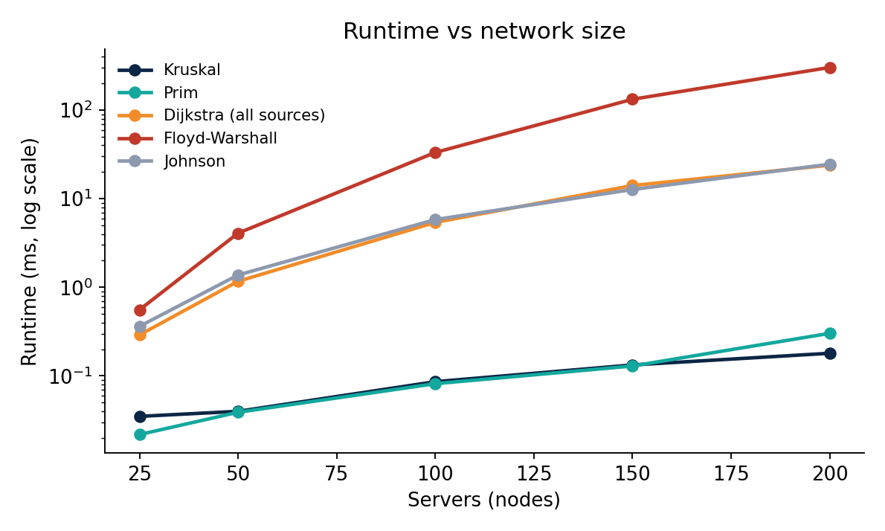
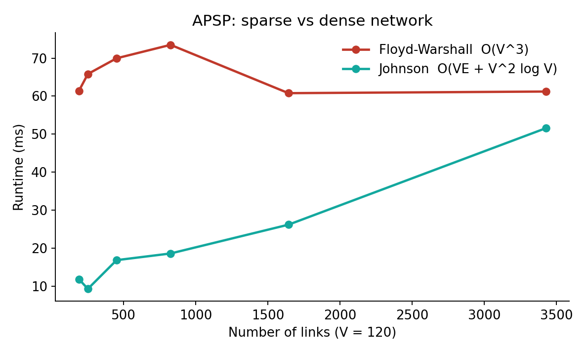
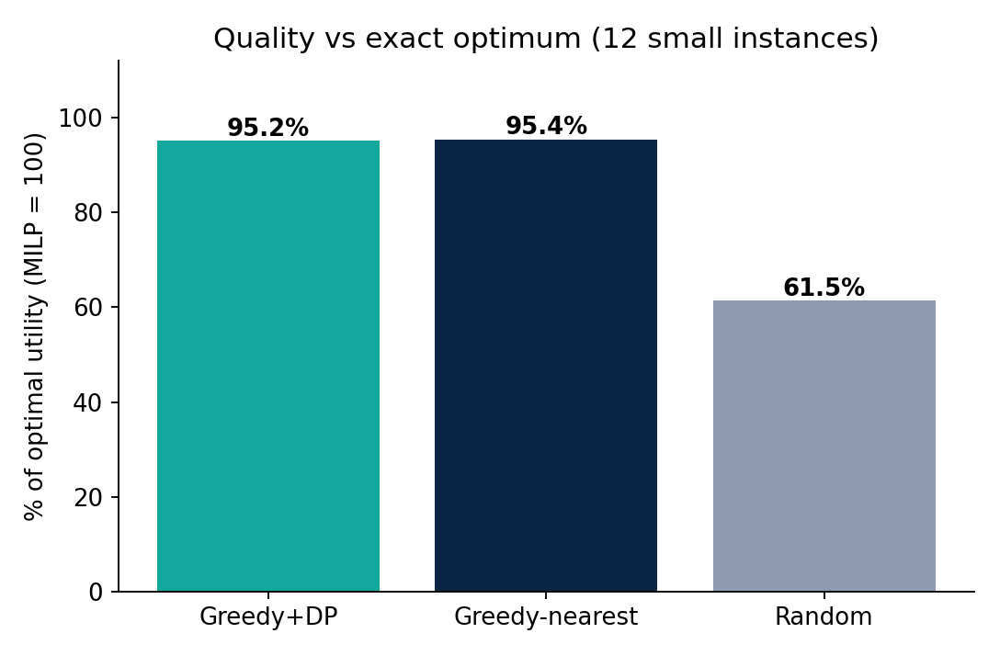
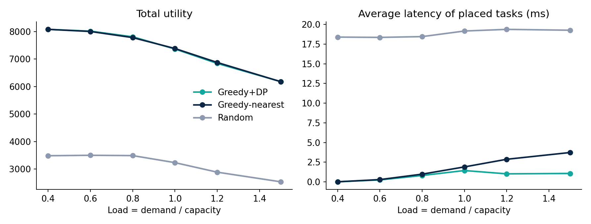

# 📑 PROJECT BASED LEARNING REPORT
# CLOUD TASK PLACEMENT USING HYBRID ALGORITHMS
### Design, Implementation and Performance Analysis of a Hybrid Algorithmic System for Latency-Aware and Capacity-Constrained Task Placement in the Cloud

**Course Name:** Design and Analysis of Algorithms  
**Semester:** 03  
**Academic Year:** 2026–27  
**Department:** Computer Science and Engineering  
**School:** School of Technology, Woxsen University  

#### 👥 Submitted by:
| S. No. | Name | Register Number |
|:---|:---|:---|
| 1 | **Andrew Devasani** | `25WU0102067` |
| 2 | **Sathyanarayana Varma** | `25WU0102088` |
| 3 | **G. Daiwik Reddy** | `25WU0102340` |
| 4 | **G. Keerthan Chowdary** | `25WU0102076` |

#### 👨‍🏫 Under the Guidance of:
**Dr. Syed Javeed Pasha**  
*Department of Computer Science and Engineering, Woxsen University*  
*October 2026*  

🌐 **Live Interactive Website:** [cloud placement](https://keerthanchowdary0369.github.io/cloud-task-placement/)  
📊 **Presentation Slides:** [PRESENTATION.md](../PRESENTATION.md)  
📥 **PowerPoint File:** [Cloud_Task_Placement_Project.pptx](Cloud_Task_Placement_Project.pptx)  

---

## 📜 CERTIFICATE
This is to certify that the project titled **“Cloud Task Placement Using Hybrid Algorithms”** is a bonafide work carried out by the following students of **B.Tech – Computer Science and Engineering** during the Academic Year 2026–27, under my supervision and guidance:
- **Andrew Devasani** (`25WU0102067`)
- **Sathyanarayana Varma** (`25WU0102088`)
- **G. Daiwik Reddy** (`25WU0102340`)
- **G. Keerthan Chowdary** (`25WU0102076`)

The project has been completed as part of the requirements of the Project Based Learning component of the B.Tech – Computer Science and Engineering programme.

**Guide Signature:** ____________________  
**Name of Guide:** Dr. Syed Javeed Pasha  
**Department:** Computer Science and Engineering  

---

## ✍️ DECLARATION
We hereby declare that the project titled **“Cloud Task Placement Using Hybrid Algorithms”** is our original work carried out under the guidance and supervision of the faculty member mentioned in this report.

The project was developed as part of the academic requirements of the B.Tech – Computer Science and Engineering programme at Woxsen University. The design, implementation, testing, experimentation, analysis, and documentation presented in this report represent the collective work of the project team.

We confirm that this work has not been submitted, either wholly or partly, for the award of any degree, diploma, certificate, or other academic qualification at this or any other institution. Wherever external books, research papers, technical documentation, algorithms, or software frameworks have been referred to, appropriate acknowledgement has been provided through numbered citations and references.

**Place:** Hyderabad  
**Date:** October 2026  

| S. No. | Name | Register Number |
|:---|:---|:---|
| 1 | Andrew Devasani | `25WU0102067` |
| 2 | Sathyanarayana Varma | `25WU0102088` |
| 3 | G. Daiwik Reddy | `25WU0102340` |
| 4 | G. Keerthan Chowdary | `25WU0102076` |

---

## 🙏 ACKNOWLEDGEMENT
We would like to express our sincere gratitude to Woxsen University, the School of Technology, and the Department of Computer Science and Engineering for providing us with the opportunity to undertake this Project Based Learning project.

We are thankful to our faculty guide, **Dr. Syed Javeed Pasha**, for his guidance, suggestions, technical feedback, and encouragement throughout the project. His feedback helped us understand how theoretical concepts from Design and Analysis of Algorithms can be applied to a practical problem.

We would also like to acknowledge the academic resources and research publications that helped us understand spanning trees, shortest-path algorithms, greedy techniques, dynamic programming, and assignment problems [1]–[10].

This project provided us with an opportunity to work as a team and understand the importance of dividing a complex problem into smaller modules. Through implementation and testing, we gained practical experience in algorithm design, software development, debugging, experimentation, and performance analysis.

---

## 📋 ABSTRACT
Cloud task placement is the problem of deciding which server runs each task. Efficient planning becomes difficult when servers have limited capacity and tasks have different demands, values, and user locations.

This project develops a hybrid algorithmic system for placing tasks under these constraints. The cloud network is represented as a weighted graph. A minimum spanning tree (Kruskal and Prim) gives a low-cost backbone [3], [4], and Dijkstra's algorithm, Bellman-Ford, Floyd-Warshall and Johnson compute latencies [5]–[9]. A greedy proposal step lets every task ask for its best server, and 0/1 Knapsack Dynamic Programming selects the most valuable subset of tasks on each server within its capacity [10]. The system is compared with nearest-first and random placement, with a greedy variant, and with an exact integer-programming optimum.

The system is implemented in Python. On synthetic data, Johnson's algorithm was about **12 times faster** than Floyd-Warshall at 200 servers. The placement reached about **95% of the optimal utility** on small instances and kept average latency about **3.5 times lower** than nearest-first under overload. The MST backbone cut link cost by **82–84%** while lowering placement utility by only 0.7–1.2%. The project also includes controlled experiments and 7 automated tests, all passing.

**Keywords:** Cloud task placement, Minimum spanning tree, Dijkstra, Johnson, Knapsack, Dynamic Programming, Greedy, Assignment problem.

---

## 📑 TABLE OF CONTENTS
1. [Chapter 1 – Introduction](#chapter-1--introduction)
2. [Chapter 2 – Problem Statement and Objectives](#chapter-2--problem-statement-and-objectives)
3. [Chapter 3 – Literature Review](#chapter-3--literature-review)
4. [Chapter 4 – Methodology and System Design](#chapter-4--methodology-and-system-design)
5. [Chapter 5 – Implementation](#chapter-5--implementation)
6. [Chapter 6 – Results and Discussion](#chapter-6--results-and-discussion)
7. [Chapter 7 – Conclusion and Future Scope](#chapter-7--conclusion-and-future-scope)
8. [Chapter 8 – Team Contributions](#chapter-8--team-contributions)
9. [References](#references)
10. [Appendices (A to F)](#appendices)

---

## CHAPTER 1 — INTRODUCTION

### 1.1 Background
A cloud is a collection of servers, usually grouped in data centres, connected by a network. Customers do not buy individual machines. They submit tasks such as virtual machines or containers, and the provider decides which physical server runs each one. This decision is called placement.

Placement matters for three reasons:
1. Every server has limited capacity (CPU cores, memory), so a task placed on a full server cannot run.
2. The network delay between the task and its users decides how fast it responds, and delay grows with distance and intermediate links.
3. Tasks differ in intrinsic value based on priority or service agreements.

The network also has a cost: physical links must be provisioned and maintained. This project models the cloud as a weighted graph and combines classical algorithms [1], [2] to obtain a feasible, high-utility placement plan.

### 1.2 Motivation
The project demonstrates how foundational DAA concepts solve a practical cloud optimization challenge:
- **Kruskal / Prim:** Cheapest backbone network.
- **Dijkstra, Bellman-Ford, Floyd-Warshall, Johnson:** Shortest path latency matrices.
- **Greedy Proposals:** Each task proposes to its highest utility server.
- **Knapsack DP:** Exact optimal task subset on each server.
- **Exact MILP Solver:** Ground truth comparison on small instances.
- **Baselines:** Nearest-First and Random placement.

### 1.3 Key Terms
| Term | Meaning |
|:---|:---|
| **Server** | A physical machine or data centre node that executes tasks. |
| **Link** | A physical network edge with latency in milliseconds. |
| **Latency** | Network delay (ms), defined as the shortest-path length between nodes. |
| **Task** | A container or VM workload with demand, value, and user origin. |
| **Demand** | Resource units required by a task on its host server. |
| **Origin** | The server node where users connect to the cloud. |
| **Utility** | Value earned minus latency penalty: $p_i - \lambda \times L(o_i, s)$. |
| **Load** | Total task demand divided by total datacenter capacity. |
| **MST** | Minimum spanning tree connecting all servers with no cycles. |
| **NP-hard** | Computational class containing problems with no known polynomial exact solver. |

---

## CHAPTER 2 — PROBLEM STATEMENT AND OBJECTIVES

### 2.1 Problem Statement
The cloud environment is modeled as a weighted undirected graph $G = (V, E)$, where $V$ represents servers and $E$ represents physical links with latency weights. Each server $s \in V$ has capacity $\text{cap}(s)$.

Each task is defined as $T_i = (d_i, p_i, o_i)$:
- $d_i$: Demand (capacity units needed)
- $p_i$: Value of the task
- $o_i$: Origin server where users connect

Placing task $i$ on server $s$ earns utility:
$$u(i, s) = p_i - \lambda \times L(o_i, s)$$
where $\lambda$ is the penalty weight per millisecond of latency (default $\lambda = 1.0$).

#### Mathematical Formulation:
$$\max \sum_{i} \sum_{s} u(i, s) \cdot x(i, s)$$
Subject to:
$$\sum_{s} x(i, s) \le 1 \quad \forall i$$
$$\sum_{i} d_i \cdot x(i, s) \le \text{cap}(s) \quad \forall s$$
$$u(i, s) > 0 \quad \text{for admitted tasks}$$
where $x(i, s) \in \{0, 1\}$.

**Computational Hardness:** On a single server, this reduces to the 0-1 Knapsack problem (NP-hard). Across multiple servers, it constitutes the **Generalized Assignment Problem (GAP)**, which is NP-hard. Hence, polynomial heuristics are essential.

### 2.2 Objectives
- **O1:** Build a low-cost backbone network (MST).
- **O2:** Compute shortest latencies between all server pairs.
- **O3:** Enable tasks to propose greedily to optimal servers.
- **O4:** Select the highest value subset on each server via 0-1 Knapsack DP.
- **O5:** Enforce strict capacity constraints without violation.
- **O6:** Benchmark against Nearest-First, Random, and exact MILP.
- **O7:** Formally analyze correctness, feasibility, and termination.
- **O8:** Measure empirical runtime scaling against asymptotic bounds.
- **O9:** Conduct sensitivity analyses on load, $\lambda$, and density.

---

## CHAPTER 3 — LITERATURE REVIEW

### 3.1 Algorithmic Foundations
| Source | Contribution | Role in Project |
|:---|:---|:---|
| **Kruskal (1956) [3]** | Greedy MST using sorted edges & Union-Find | Backbone network |
| **Prim (1957) [4]** | MST grown from one node via binary heap | Cross-check of Kruskal |
| **Dijkstra (1959) [5]** | Single-source shortest paths for non-negative edges | Server-to-server latency |
| **Bellman (1958) [6]** | Shortest paths with negative edges & cycle check | Reweighting potential $h(u)$ |
| **Floyd (1962) [7] / Warshall (1962) [8]** | All-pairs shortest paths by dynamic programming, $O(V^3)$ | Dense-mesh latency matrix |
| **Johnson (1977) [9]** | APSP for sparse graphs via Bellman-Ford reweighting | Sparse-mesh latency matrix |
| **Martello & Toth (1990) [10]** | Knapsack problems: DP and branch-and-bound | Per-server task selection |
| **Cormen et al. [1], Kleinberg & Tardos [2]** | Complexity analysis and exchange arguments | Correctness arguments |

### 3.2 Knapsack to Cloud Placement Mapping
| 0-1 Knapsack Concept | Cloud Task Placement Concept |
|:---|:---|
| Item | Task $t$ |
| Item Weight | Task Demand $d_t$ |
| Item Value | Net Utility $u(t, s) = p_t - \lambda \cdot L(o_t, s)$ |
| Knapsack Capacity | Remaining Server Capacity $\text{remaining}[s]$ |

---

## CHAPTER 4 — METHODOLOGY AND SYSTEM DESIGN

### 4.1 Proposed System Architecture
The 5-stage pipeline operates as follows:
```
Input Data (Servers, Tasks, Topology)
   │
   â–¼
Graph Construction (Adjacency Lists)
   │
   â–¼
MST Backbone (Kruskal & Prim, V-1 Links)
   │
   â–¼
Latency Matrix (Floyd-Warshall or Johnson)
   │
   â–¼
Proposal Rounds (Greedy Task Proposals)
   │
   â–¼
Knapsack DP per Server (Capacity Check)
   │
   â–¼
Final Output (Placement Plan, Utility, Metrics)
```

### 4.2 Sample Six-Server Network
To illustrate every algorithm by hand, a 6-server network with 9 links is analyzed:
- **Servers:** $S_0 (C=5)$, $S_1 (C=3)$, $S_2 (C=4)$, $S_3 (C=4)$, $S_4 (C=3)$, $S_5 (C=3)$.
- **Links:** $(0,1): 4$, $(0,2): 2$, $(1,2): 1$, $(1,3): 5$, $(2,3): 8$, $(2,4): 10$, $(3,4): 2$, $(3,5): 6$, $(4,5): 3$.
- **Tasks:** $T_0(d=3, p=30, o=0)$, $T_1(d=4, p=25, o=0)$, $T_2(d=2, p=20, o=1)$, $T_3(d=3, p=35, o=3)$, $T_4(d=4, p=28, o=4)$, $T_5(d=2, p=15, o=5)$.

### 4.3 Placement Algorithm Workflow
```python
while pending_tasks:
    for t in pending_tasks:
        s = best_server(t)  # highest u(t, s) > 0 and s not banned
        if s is None:
            drop(t)
        else:
            proposals[s].append(t)
            
    for s, tasks in proposals.items():
        chosen = knapsack_01(tasks, remaining_capacity[s])
        for t in tasks:
            if t in chosen:
                assign[t] = s
                remaining_capacity[s] -= demand[t]
                pending_tasks.remove(t)
            else:
                banned[t].add(s)
```

#### Correctness Arguments:
1. **Feasibility:** In each round, every server solves Knapsack DP bounded strictly by `remaining[s]`. Demands are subtracted immediately; capacity is never exceeded.
2. **Termination:** Every rejected task bans that server. Since there are only $|S|$ servers, every task terminates in $\le |S| + 1$ rounds.
3. **Local Optimality:** Knapsack DP is exact ($O(nC)$) for each server's proposal batch.

---

## CHAPTER 5 — IMPLEMENTATION

### 5.1 Project Modules
- `graph.py` (Adjacency-list graph, topology and workload generator)
- `mst.py` (Kruskal with Union-Find, Prim with binary heap)
- `shortest.py` (Dijkstra, Bellman-Ford, Floyd-Warshall, Johnson)
- `dp.py` (0-1 Knapsack DP with back-pointer item recovery)
- `greedy.py` (Fractional knapsack, Job sequencing)
- `placement.py` (Greedy+DP solver, Nearest-First, Random, exact MILP)
- `run_experiments.py` (Empirical evaluation and plot generation)
- `tests/test_all.py` (7 automated verification tests)

### 5.2 Automated Test Suite
| Test Case | Verification Criteria | Status |
|:---|:---|:---:|
| **Kruskal equals Prim** | Equal total weight and exactly $V-1$ links on 5 random networks | **PASS** |
| **Shortest Paths Agreement** | Dijkstra, Bellman-Ford, Floyd-Warshall, and Johnson agree on distances | **PASS** |
| **Johnson Negative Edges** | Correct distances on graph containing negative edges | **PASS** |
| **Negative Cycle Detection** | Bellman-Ford correctly detects negative-weight cycles | **PASS** |
| **Knapsack vs Brute Force** | DP equals exhaustive search across 30 random cases | **PASS** |
| **Job Sequencing** | Yields known optimal profit ($142$) on textbook example | **PASS** |
| **Placement Quality** | Plan is feasible and achieves $\ge 85\%$ of MILP optimum | **PASS** |

**Total:** 7/7 tests pass successfully.

---

## CHAPTER 6 — RESULTS AND DISCUSSION

### 6.1 Worked Example on 6-Server Network
- **MST Weight:** $13\text{ ms}$ (vs $41\text{ ms}$ full mesh) $\implies$ **68.3% link cost reduction**.
- **Latency Matrix ($L$):**
  - $L(0, 1) = 3\text{ ms}$ via $0 \to 2 \to 1$ (faster than direct link $4\text{ ms}$).
- **Placement Plan:**
  - $T_0 \to S_0$ (Demand 3, Util 30)
  - $T_1 \to S_2$ (Demand 4, Util 23)
  - $T_2 \to S_1$ (Demand 2, Util 20)
  - $T_3 \to S_3$ (Demand 3, Util 35)
  - $T_5 \to S_5$ (Demand 2, Util 15)
  - **Total Utility:** $123$, Placed: 5/6 (83.3%), Avg Latency: $0.4\text{ ms}$.

### 6.2 Empirical Benchmark Summary

#### 1. Runtime Scaling vs Size (25 to 200 Servers)

- At 200 servers: **Johnson took 24.54 ms vs 303.20 ms for Floyd-Warshall (12.4x faster)**.
- Kruskal and Prim execute in under **$0.3\text{ ms}$**.

#### 2. Sparse vs Dense APSP (V = 120 Servers)

- At 191 links: Johnson is **5.2x faster** than Floyd-Warshall (11.9 ms vs 61.4 ms).
- Floyd-Warshall remains flat at $\sim 61\text{ ms}$ across all densities, proving the $O(V^3)$ bound.

#### 3. Solution Quality vs Exact MILP (12 Instances)

- **Greedy + DP:** **95.2%** of global mathematical optimum.
- **Greedy-Nearest:** **95.4%** of optimum.
- **Random Baseline:** **61.5%** of optimum.

#### 4. Behavior Under Heavy Cloud Overload (Load 0.4 to 1.5)

- At Load = 1.5: **Greedy+DP keeps average latency at 1.07 ms vs 3.73 ms for Nearest-First (3.5x lower)** at identical total utility ($6,182$).
- Tasks placed: **70.6%** (Greedy+DP) vs **67.9%** (Nearest-First).

#### 5. Backbone Network Savings
- **Link Reduction:** $73.4\%–74.1\%$ links trimmed.
- **Cost Reduction:** $81.9\%–83.6\%$ total physical link cost cut.
- **Placement Impact:** Restricting placement to tree routes reduced utility by only **$0.7\%–1.2\%$**.

---

## CHAPTER 7 — CONCLUSION AND FUTURE SCOPE

### 7.1 Conclusion
The project successfully developed a hybrid algorithmic system for cloud task placement combining graph theory, greedy heuristics, and dynamic programming:
1. Demonstrates that textbook algorithms have synergistic real-world applications when linked in a multi-stage pipeline.
2. Achieves **95.2% of the global MILP optimum** in polynomial time.
3. Provides **3.5x lower latency** under heavy datacenter overload.
4. Delivers an interactive web platform and automated verification suite.

### 7.2 Future Scope
- **Multi-Resource Vectors:** Support CPU, memory, GPU, and bandwidth simultaneously using multidimensional knapsack DP.
- **Online Dynamic Arrivals:** Handle real-time workload arrival, departure, and live VM migration.
- **Fault-Tolerant Replicas:** Ensure high availability by placing secondary replica tasks on distinct physical fault domains.

---

## CHAPTER 8 — TEAM CONTRIBUTIONS
| Member | Responsibilities & Modules |
|:---|:---|
| **Andrew Devasani** (`25WU0102067`) | Graph topology modeling, synthetic workload generator, and MST algorithms (`graph.py`, `mst.py`). |
| **Sathyanarayana Varma** (`25WU0102088`) | Shortest path algorithms (Dijkstra, Bellman-Ford, Floyd-Warshall, Johnson) (`shortest.py`). |
| **G. Daiwik Reddy** (`25WU0102340`) | Knapsack DP with item recovery, fractional knapsack bounds, and job sequencing (`dp.py`, `greedy.py`). |
| **G. Keerthan Chowdary** (`25WU0102076`) | Two-phase placement engine, MILP exact solver, benchmarking suite, and interactive web dashboard (`placement.py`, `run_experiments.py`, `index.html`). |

---

## REFERENCES
1. T. H. Cormen, C. E. Leiserson, R. L. Rivest, and C. Stein, *Introduction to Algorithms*, 4th ed., MIT Press, 2022.
2. J. Kleinberg and E. Tardos, *Algorithm Design*, Pearson, 2006.
3. J. B. Kruskal, “On the Shortest Spanning Subtree of a Graph and the Traveling Salesman Problem,” *Proc. Amer. Math. Soc.*, vol. 7, no. 1, pp. 48–50, 1956.
4. R. C. Prim, “Shortest Connection Networks and Some Generalizations,” *Bell System Technical Journal*, vol. 36, no. 6, pp. 1389–1401, 1957.
5. E. W. Dijkstra, “A Note on Two Problems in Connexion with Graphs,” *Numerische Mathematik*, vol. 1, pp. 269–271, 1959.
6. R. Bellman, “On a Routing Problem,” *Quarterly of Applied Mathematics*, vol. 16, no. 1, pp. 87–90, 1958.
7. R. W. Floyd, “Algorithm 97: Shortest Path,” *Communications of the ACM*, vol. 5, no. 6, p. 345, 1962.
8. S. Warshall, “A Theorem on Boolean Matrices,” *Journal of the ACM*, vol. 9, no. 1, pp. 11–12, 1962.
9. D. B. Johnson, “Efficient Algorithms for Shortest Paths in Sparse Networks,” *Journal of the ACM*, vol. 24, no. 1, pp. 1–13, 1977.
10. S. Martello and P. Toth, *Knapsack Problems: Algorithms and Computer Implementations*, John Wiley and Sons, 1990.
11. Python Software Foundation, “Python Standard Library — heapq Module.”
12. SciPy Developers, “SciPy Documentation: scipy.optimize.milp.”
13. Matplotlib Development Team, “Matplotlib Documentation.”

---

## APPENDICES

### Appendix A – Sample Output
- **Placed Tasks:** 0, 1, 2, 3, 5 (Task 4 could not be placed due to capacity constraint).
- **Total Utility:** $123$.
- **Total Demand Placed:** $14$ units.
- **Capacity Utilization:** $63.6\%$.
- **Rounds Required:** $7$ rounds ($\le |S| + 1$).
- **Capacity Violations:** $0$ (Feasibility preserved).

